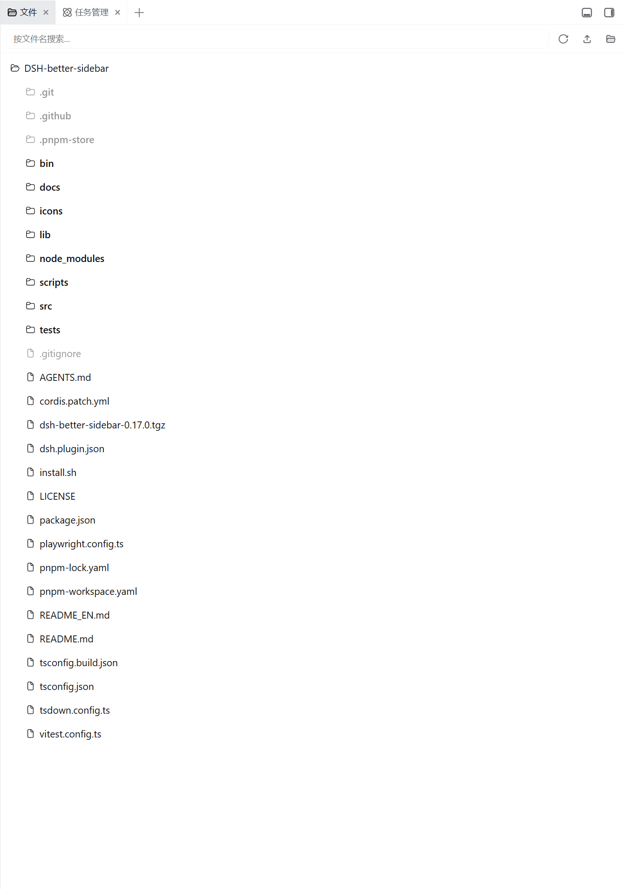
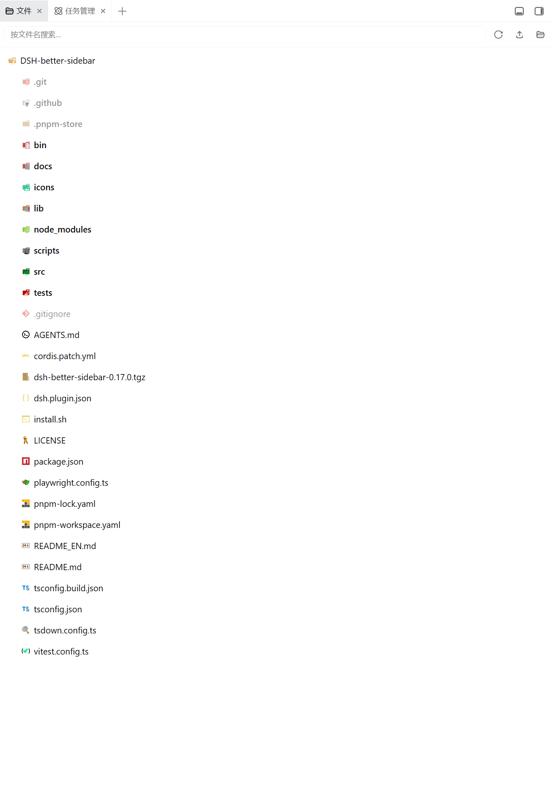

<div align="center">

# dsh-better-sidebar-icons

**VSCode 风格文件 / 文件夹图标主题**：给 DSH 右侧栏的资源管理器换上熟悉的开发环境图标（文件树 + 文件页签）。

优先走宿主公开的 `registerFileIcon` 接口 · 无接口时退回纯 DOM 覆盖 · 不修改 DSH 源码 · 安装 / 卸载零残留

[](LICENSE)
[](https://github.com/vscode-icons/vscode-icons)

</div>

---

## 📸 效果对比

<table>
<tr>
  <td align="center"><b>安装前</b><br><sub>DSH / better-sidebar 默认图标</sub></td>
  <td align="center"><b>安装后</b><br><sub>本插件 · VSCode 风格图标</sub></td>
</tr>
<tr>
  <td align="center"></td>
  <td align="center"></td>
</tr>
</table>

## ✨ 特性

- **文件树图标**：资源管理器每一行按 basename / 扩展名匹配对应图标（`file_type_typescript.svg`、`file_type_json.svg` …），文件夹按开 / 合状态取 `folder_type_*` / `*_opened` 变体
- **两条实现路径，自动择一**（见[工作原理](#️-工作原理)）：
  - **服务路径**（`dsh-better-sidebar` ≥ 0.19.1）：经宿主公开的 `ctx.betterSidebar.registerFileIcon` 注册整张主题表，宿主自己渲染我们的图标 —— 拿到真实路径与开 / 合态，不碰 DOM
  - **覆盖路径**（无此服务，即 DSH 自带资源管理器）：`MutationObserver` + 注入样式表在 DOM 上替换图标
- **VSCode 同款匹配语义**：精确 basename → 大小写不敏感 basename → 扩展名逐段最长优先（先精确后宽松）
- **自动适配主题**：light / dark 颜色方案自动切换（跟随 `body[data-ds-dark-theme]`），两种路径都支持
- **图标服务路由**：host 半提供 `/dsh-better-sidebar-icons/icons/<name>.svg`（白名单校验 + 浏览器信任栅栏 + ETag/304 缓存）
- **安全兜底**：未匹配到的文件回退默认图标，视觉上仍清晰可辨

## 📦 安装

```bash
dsh plugin --profile web add dsh-better-sidebar-icons
```

从源码安装：

```bash
git clone https://github.com/eg-bole/dsh-better-sidebar-icons.git
cd dsh-better-sidebar-icons
pnpm install
pnpm build
dsh plugin --profile web add link:"$PWD"
```

改完 `lib/client.js` 后重启 `dsh web` 并硬刷新页面即可生效。

## 🗑️ 卸载

```bash
dsh plugin --profile web remove dsh-better-sidebar-icons
```

卸载（或插件禁用 / 热重载）时：服务路径注销全部描述符，覆盖路径把所有被替换的图标**恢复为宿主原样**，零残留。

## ✅ 适用版本

本插件自身要求 **DSH `0.1.7-rc.1+`**（两条路径都用该版本起的稳定钩子）。

| 你的右侧栏资源管理器 | 走的路径 | `dsh-better-sidebar` |
|---|---|---|
| `dsh-better-sidebar`（占用 `files` 页签） | 服务路径 | 需要 **≥ 0.19.1**（该版本才有 `registerFileIcon`） |
| DSH 自带 `dsh-client-ui-sidebar-files` | 覆盖路径 | 不需要 |

两条路径的判定是自动的：插件启动时查 `ctx.betterSidebar`，有且带 `fileIcons` 能力就走服务路径，否则覆盖路径。

## ⚙️ 工作原理

### 服务路径（首选）

`dsh-better-sidebar` 从 0.19.1 起删掉了自带图标表，改为对外开放 `registerFileIcon`（能力名 `fileIcons`），文件树与文件页签的图标都走这个接口解析。本插件注册三张描述符，正好覆盖整张主题：

| 描述符 | 内容 | 在宿主的解析顺序里 |
|---|---|---|
| `…:file-names` | 主题知道的全部精确 basename（`package.json` …） | 第 1 档 |
| `…:folder` | 全部目录名 + `folder` / `folder-open` 两个保留扩展名 | 目录行第 1、2 档 |
| `…:file-exts` | `exts: []`，即全局兜底 | 最后 |

宿主自己的解析顺序是「文件：`names` → `exts` → `exts: []` → 内置表；目录：`folderNames` → `folder`/`folder-open` → 内置」，因此注册完这三张表后，**内置图标表不会再出现在树里**，主题是完整的。图标由宿主的 React 渲染成我们返回的元素，因此**不碰任何 DOM**，也没有需要还原的痕迹。

颜色方案切换时，图标元素自己订阅 `body[data-ds-dark-theme]` 并就地重解析 —— 这个订阅必须由元素自己持有：宿主只会在渲染时调用工厂，它并不知道方案变了，普通的元素不会因此重渲染。

### 覆盖路径（退回）

DSH 自带的资源管理器（`dsh-client-ui-sidebar-files`）**没有图标主题扩展点**，其图标渲染自 `ui-primitives` 的 `FileTypeIcon`，只能做 DOM 覆盖。锚点全部使用宿主公开的稳定钩子，不依赖任何 CSS Modules 哈希：

| 位置 | 锚点 |
|---|---|
| 文件树行 | `li[data-files-entry="file"｜"directory"][data-files-path]`，行内 `button[aria-expanded]` 表示文件夹开 / 合 |
| 文件树根 | `[data-files-root]`（工作区路径），用于给 `files` 页签命名 |
| Tab 页签 | `span[data-sidebar-right-tab]`；`files` 页签与文件页签通过宿主画的 `FileTypeIcon`（带 `data-file-type-mark`，或 viewBox 为 `0 0 28 28` / `0 0 20 20` / `0 0 16 16`）识别，Chrome 图标与引导列表项两者都不满足 |

`files` 页签的名字来自「树还挂载时」记下的工作区根目录（按页签 id 记；切到别的页签后树会卸载，整个 pane 还会被重挂载，届时 DOM 里已经没有根路径了）。

- **client half**（浏览器）：`MutationObserver` 持续扫描上述锚点，用匹配引擎把名字解析成图标文件，把宿主 svg 标记为隐藏、并在其旁插入一个指向插件路由的 ``；React 重渲染后自动重应用，卸载时全部恢复。
- **host half**（Node）：`/dsh-better-sidebar-icons/icons/<name>.svg` 路由，白名单 + 浏览器信任栅栏（同 /api 网关的 DNS-rebinding 防线）+ ETag/304。

#### 为什么不直接替换宿主节点

宿主把图标渲染成受 React 管理的受控元素。直接换掉它会破坏 React 的 DOM 记账（fiber 仍指向旧 svg，下一次 commit 会对已脱离的节点调用 `removeChild`，整棵树崩溃）。因此：

1. 宿主 svg **原地保留**，由插件注入的一条样式表规则隐藏（`[data-dsh-file-icon-overlay] > svg` 一族，含 slot 包装层，带 `!important`，保证不会被宿主重新写回的内联样式顶掉）；
2. 我们的 `` 插在它旁边，React 可以自由增删自己的节点；
3. React 重建出的新 svg 只要还在被标记的父元素内，就被同一条规则隐藏，无需重扫。

### 服务路径覆盖不到的地方

`registerFileIcon` 只喂**文件树的行**与**编辑器文件页签的 chip**。以下位置宿主没有走这个接口，因此不在主题范围内：

- **Tab chip 上的 `files` 页签图标**：那块图标由 `ui-sidebar-right` 的 tab-title 槽自己画（一个固定的文件夹图形），既不查服务也不查 DSH 的图标表。要换它只能改 DSH 源码或覆盖 DOM —— 两者都不做（见仓库规则：不改 DSH 源码）。
- **聊天 / 附件 / 产物行**里的文件图标：属于对话区，不是资源管理器。

## 🎯 匹配语义

- **文件**：精确 basename → 大小写不敏感 basename → 扩展名候选（`archive.tar.gz` → `gz`、`tar.gz`，**最长优先**，各先精确后宽松）→ 默认图标
- **文件夹**：精确 → 宽松，按开 / 合态分别匹配 `folderNames` / `folderNamesOpen`
- **根目录**：文件树顶部是完整路径标签（`PathLabel`），不是文件夹行，因此保持宿主原样；只有 `files` 页签图标按根目录名解析

## 🔄 重新生成图标

`icons/` 与 `src/client/icons-manifest.generated.ts` 是**提交产物**（构建自包含）。上游 vscode-icons 资产更新时才需要重新生成：

```bash
node scripts/gen-icons.mjs --vscode-icons <vscode-icons-checkout>
```

## 🛠️ 开发

```bash
pnpm install
pnpm typecheck   # tsc --noEmit
pnpm test        # vitest（匹配引擎 / 路由 / 服务描述符 / DOM 覆盖 / 发布产物装载）
pnpm build       # tsdown（lib/index.js + lib/client.js）+ 声明
```

- `tests/service-icons.spec.ts` 钉住服务契约：三张描述符的 id / 顺序 / 内容，宿主那套解析顺序的复演，工厂产出的 ``（尺寸、标记、`aria-hidden`），以及方案切换后的重解析。
- `tests/override.spec.ts` 的 DOM fixture 按 `ui-sidebar-files` FilesBody/FilesTitle 与 `ui-sidebar-documentpreview` TextTitle 的真实结构搭建（含 slot 的 `div[data-slot]` 包装层），锚点契约一旦变动就会红。
- `tests/bundle.spec.ts` 装载**发布产物** `lib/client.js`：走 `window.__ModuleLoader__` 与桩 `require`，覆盖 banner/footer/CJS 包装、`apply`/`inject` 入口，以及两条路径的择一（含「服务稍后才就绪，走 `ctx.inject` 等待」这条竞态）。改动构建配置后先 `pnpm build` 再跑测试。

> ⚠️ 客户端半不得写 `import ... from 'react'` 或字面量 `require('react')`：打包器会**把 React 源码本身**塞进 bundle，得到第二份 React 实例，其 hook 属于宿主从未安装的 dispatcher，每个图标都会 `Invalid hook call`。宿主在 boot 的 `staticModules` 里为 `react` / `react/jsx-runtime` / `react-dom` 等播了种，本插件用**拼出来的** specifier 走 module-loader `require` 借用宿主的 React（字面量会被静态解析并内联）。`tests/bundle.spec.ts` 会因此断言除 `react` 之外没有任何 `require`。

### 真机视觉确认

两个 harness 都用 Playwright 驱动真实的 `dsh web`（已全局安装 playwright 与 chromium；脚本会先从本地、再从全局 npm root 解析）。

```bash
npm i -g playwright && npx playwright install chromium
pnpm build
dsh web --port 3099 --no-open
```

**服务路径**（右侧栏由 `dsh-better-sidebar` 提供，即默认情形）：

```bash
node scripts/visual-service.mjs "http://127.0.0.1:3099/?token=<终端打印的 token>" .visual/final
```

打开引导列表里的 `files` 页签、展开目录、点开一个文件，然后落盘每个树行的「主题 img src + 尺寸 + 该行还剩几个宿主 svg」，以及截图，最后**就地把主题 img 全部删掉**作为对照。判定标准是每行 `hostGlyphs: 0`（宿主图标已被取代，而非叠在下面）。

**覆盖路径**（需要先让原生资源管理器露面）：

```bash
dsh web --patch scripts/only-native-explorer.yml --port 3099 --no-open
node scripts/visual-confirm.mjs "http://127.0.0.1:3099/?token=<token>" .visual/native
```

产物包含 `40-tree-with-plugin.png`、`41-file-tab-with-plugin.png`、`42-tree-plugin-unmounted.png` 与 facts JSON。

### ⚠️ `dsh-better-sidebar` 会盖住 DSH 原生资源管理器

`dsh-better-sidebar` 与 DSH 自带资源管理器注册的是**同一个 `files` 页签类型**，而原生注册表允许「更高优先级的 band 接管同一类型」：better-sidebar 用 `priority: 'extension'`，原生那个是 `'builtin'`，extension 档更高，于是原生资源管理器被 shadow，**既不渲染也不会出现在引导列表里**。用 `scripts/only-native-explorer.yml` 把 better-sidebar 停掉，同一个 `data-sidebar-right-guide-entry="files"` 入口才交给原生资源管理器。

本插件不要求你做这个取舍：better-sidebar 开着就走服务路径（推荐，还能保留它的编辑器等工作台能力），关掉就走覆盖路径。

## 📄 许可

MIT。图标资产来自 [vscode-icons](https://github.com/vscode-icons/vscode-icons)（MIT），匹配语义遵循 VSCode better-sidebar-icons 引擎（MIT）。
